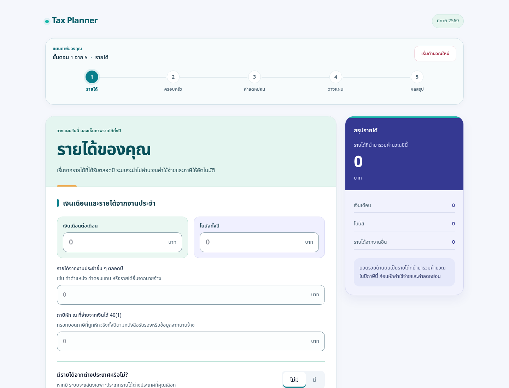
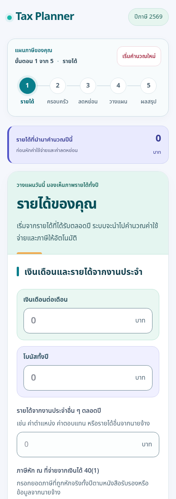

# B1 — Fresh Teal + Soft Indigo visual revision

Base: `a6365df8926c8ea0b88140e23fc4a8451dfc4551` (merged P1a).
Official Production remains **taxplannervid / https://taxplannervid.vercel.app**.
This branch is for Director review in a Draft PR, not a release. No manual deployment,
merge, auto-merge, Vercel setting or legacy-project change is included.

## Design boundaries

The existing Next.js/React/Tailwind architecture and all business rules are retained.
No UI libraries or dependencies were added. No third-party artwork/design/source was copied.

- `planning-design-system.css`: semantic Fresh Teal tokens, typography/spacing/radii,
  button/card/alert/form foundations, keyboard focus and reduced-motion handling.
- `PlanningStepper`: ordered five-link navigation, current step, positional prior-step
  check marks, responsive equal-width mobile columns and unchanged destinations. Prior-step
  marks are sequence indicators, **not validation that financial data is complete**;
  accessible names say “ขั้นตอนก่อนหน้า”. Reset remains the same action.
- Income: broader desktop canvas, grouped card, Thai heading/intro, teal information,
  tabular financial figures, sticky desktop summary, readable controls and consistent actions.
- Root: Thai language metadata and Noto Sans Thai through the existing next/font pipeline;
  this intentionally improves shared typography. Font assets are self-hosted by Next after
  build; the build needs Google Fonts access, as the existing Geist setup already did.
- All pilot-specific form/color overrides are scoped to `.tp-income`. Remaining four pages
  retain their content/layout/calculations and receive only shared shell/typography changes.
- Income-only foreign-income/FTC components gain unique label/control associations;
  their handlers, field behavior and rules are unchanged. MoneyInput formatting/parsing
  and numeric keyboard mode remain unchanged; no new rounding/formatting semantics.

## Director-requested visual revision

Reviewed predecessor: `41d14630ce97bb99cd856afdcca21db7416f9e14`.
The revision strengthens visual hierarchy without a marketing hero: mint introduction,
larger Thai heading, salary/bonus groups with distinct surfaces, confident indigo summary,
clearer breakdown rows and a compact mobile financial-feedback strip. The strip uses the
existing `totalIncome` and `formatNumber` directly; it introduces no formula, saving estimate,
input, navigation or persistence behavior. It is hidden on desktop where the existing summary
is visible beside the form. Shared navigation keeps its structure and only receives surface polish.
Form content is not hidden/clipped to conceal overflow; focus indicators remain unobstructed.

| Required evidence | Original B1 (before) | Revised application (after) |
| --- | --- | --- |
| Income desktop, 1440px | [Before](evidence/after-income-desktop.png) | [After](evidence/revision-income-desktop.png) |
| Income mobile, 390px | [Before](evidence/after-income-mobile.png) | [After](evidence/revision-income-mobile.png) |
| Navigation mobile, 375px | [Before](evidence/after-navigation-mobile.png) | [After](evidence/revision-navigation-mobile.png) |
| Financial Summary close-up | [Before](evidence/original-b1-summary.png) | [After](evidence/revision-summary.png) |
| Family/shared shell, 390px | [Before](evidence/original-b1-family-mobile.png) | [After](evidence/revision-family-mobile.png) |

Original B1's three requested Income/navigation captures are retained unchanged. Supplemental
before captures for Summary and Family were taken from the unchanged B1 production build
before editing. Summary close-ups use the same synthetic monthly salary 100,000 and bonus
50,000, yielding the existing annual income total 1,250,000. Full-page/viewport captures use
empty synthetic contexts for like-for-like comparison. No AI mockups or real customer data.
An additional [revised Results compatibility capture](evidence/revision-results-mobile.png)
is included; the Results page source itself is unchanged.

## Original B1 evidence (retained history)

Captured from local production builds in isolated Chromium using empty synthetic browser
contexts. These are real application screenshots, not generated mockups. Before is the
verified main baseline; after is the implemented B1 interface. Images are viewport captures,
not proof of every conditional field or entire long-page content.

| View | Before | After |
| --- | --- | --- |
| Income desktop, 1440px | [Before](evidence/before-income-desktop.png) | [After](evidence/after-income-desktop.png) |
| Income mobile, 390px | [Before](evidence/before-income-mobile.png) | [After](evidence/after-income-mobile.png) |
| Mobile navigation, 375px | [Before](evidence/before-navigation-mobile.png) | [After](evidence/after-navigation-mobile.png) |
| Existing Results + shell, 390px | [Before](evidence/before-results-mobile.png) | [After](evidence/after-results-mobile.png) |

## Accessibility review

- `lang=th`, Thai font with system fallbacks and readable line height.
- Navigation uses nav/ol/li, one aria-current=step, named links, decorative hidden check icons.
- Step links have measured >=44px width/height at the five specified viewports. Reset has a
  44px minimum height and retains its hydration-disabled behavior.
- Form fields gain explicit label associations; repeated records use existing item IDs or
  React useId. Help text is associated with MoneyInput descriptions. Selected-option buttons
  expose aria-pressed using the exact existing visual-selection condition.
- Focus outline is visible; CSS respects reduced-motion preferences. Financial summaries
  retain tabular numerals and wrap safely; information/validation text remains available.
- Sample contrast ratios: white/primary 4.81:1; muted text/white 5.90:1; input border/white
  3.31:1; warning text/surface 6.23:1; information text/surface 6.06:1.
- This is a targeted review, not a complete WCAG certification or assistive-technology audit.

## Verification

- Full Vitest: **337 passing / 17 files** = existing 331 unchanged + 6 navigation regression cases.
- ESLint, TypeScript no-emit, production build (11 static pages) and git diff checks passed.
- TypeScript AST comparison against baseline confirmed unchanged financial input props,
  event handlers, format/parse functions and non-render function statements in Income,
  foreign fields/FTC and Reset (excluding the new useId declarations).
- Exact diff of Tax Engine/Rules/tests, TaxPlannerContext/store, P1a, event/access rules,
  live API/Team Access, the other four page sources and dependency manifests is empty.
- Chromium QA is reproducible with `tests/ui/ux-b1.py` against a **local** production build.
  It uses external preinstalled QA tooling (Python Playwright + Chromium), not a new
  application dependency. It refuses non-local URLs and uses synthetic isolated contexts.
- See [QA details](qa.md) for observed browser results and limitations.

## Director review / B2 recommendation

Review the Income pilot visually and functionally before extending the system. B2 should
apply the accepted tokens/card/form patterns to Family and Deductions in a separate controlled
PR, while preserving every deduction/eligibility input and calculation. Results table and
Planner redesign remain later work. No P1b, Staff Login or Company QR work is included.

- [ ] Director approves desktop/mobile visuals and step progression semantics.
- [ ] Director reviews input/conditional-field preservation and Reset behavior.
- [ ] Physical iPhone Safari / Android Chrome and screen-reader acceptance recorded separately.
- [ ] Stop at Draft PR: no merge, auto-merge or manual deployment.
